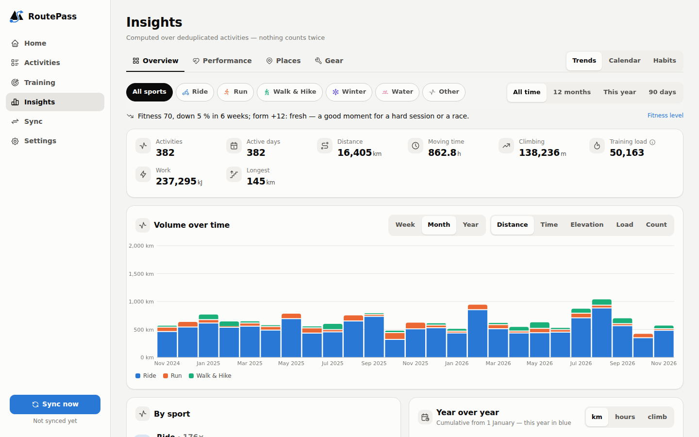
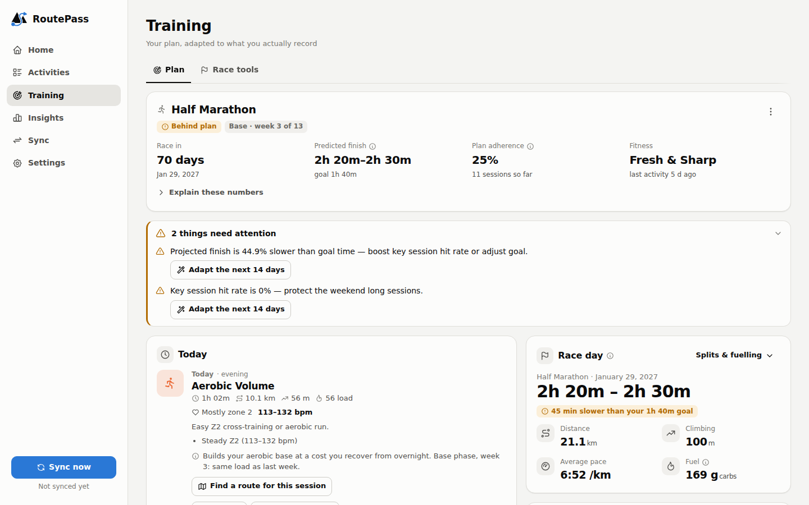
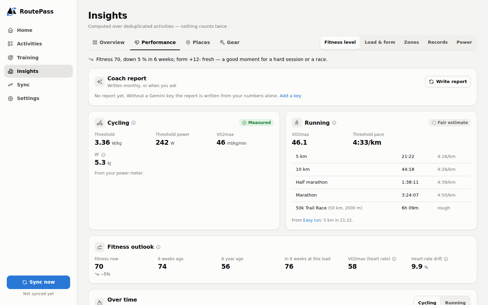
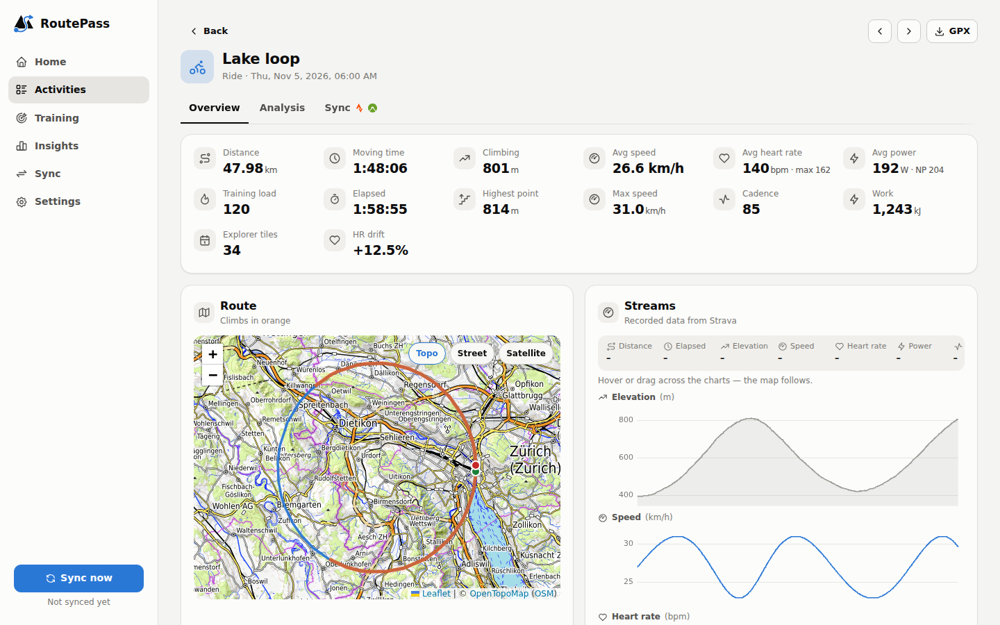

<!-- portfolio:date=2026-04-15 -->
# RoutePass

**[English](README.md) · [Deutsch](README.de.md)**

<p align="center"></p>

RoutePass ist eine selbst gehostete Strava ⇄ Komoot-Synchronisation und Trainings-App für eine Person. Beide Plattformen ergeben eine duplikatfreie Aktivitätshistorie für FastAPI-Backend, React-Web-App und einen MCP-Server für KI-Assistenten.

## Highlights

- **Duplikatfreie Zwei-Wege-Sync** — Strava-Aktivitäten und Komoot-Touren werden zu einer Aktivität zusammengeführt (±10 min, ±15 % Distanz); Regeln steuern jede Kopie, eine Retry-Queue beachtet Rate-Limits.
- **LLM-Coach mit Leitplanken** — Gemini läuft im Hintergrund-Worker und schreibt nur Text oder schlägt Planänderungen vor; der Code rechnet alle Zahlen, lehnt unsichere Änderungen ab, mit Regel-Fallbacks.
- **Track-Analyse mit NumPy** — bereinigte Höhenmeter, Normalized Power und TSS/hrTSS, Herzfrequenz- und Leistungszonen, Anstiegserkennung, steigungskorrigiertes Tempo (Minetti) und aerobe Entkopplung, geprüft an zehn echten Komoot-Aufzeichnungen (Distanz auf 1–4 % genau).
- **Fitness-Schätzungen aus Physik** — Rad-Schwellenleistung und VO2max aus einem Powermeter oder ohne eines aus gleichmäßigen Anstiegen (Schwerkraft, Roll- und Luftwiderstand); Lauf-VO2max (Daniels VDOT), Wettkampfprognosen und ein Fitness-Ausblick über sechs Wochen.
- **Adaptive Trainingspläne** — periodisierte Pläne für Trail, Straße, Rad und Triathlon; aufgezeichnete Aktivitäten werden Einheiten zugeordnet und bewertet, das Belastungsempfinden fließt in die Last ein, und jede Einheit bekommt Routenvorschläge aus der eigenen Historie und von Komoot.
- **Eine Service-Schicht, zwei Schnittstellen** — 126 REST-Endpunkte (OpenAPI) und 60 MCP-Tools rufen dieselben Funktionen auf, sodass ein KI-Assistent alles kann, was die Web-App kann.
- **Schlank im Betrieb** — ein Container (API, Scheduler, MCP, statischer Web-Build) und eine SQLite-Datei im WAL-Modus mit versionierten Migrationen; gespeicherte Zugangsdaten sind mit Fernet verschlüsselt.

## Screenshots

<p align="center">
    
</p>

Alle Screenshots zeigen die synthetischen Demodaten aus `server/scripts/seed_demo.py` (Oberfläche auf Englisch).

## Architektur

```
┌──────────────── routepass-Container (ein Python-Prozess) ─────────────────┐
│  /             React-App (statischer Build)                               │
│  /api/v1/*     REST (FastAPI, OpenAPI unter /api/docs) ─┐                 │
│  /mcp          MCP, Streamable HTTP                    ─┼─► services.py   │
│  Scheduler     Sync-Zyklus alle 30 min / per Webhook   ─┤   engine/       │
│  KI-Coach      Hintergrund-Worker, ein Job zur Zeit    ─┘   analysis/     │
│                                                                           │
│  SQLite (WAL)  /data/routepass.db     Fernet-Schlüssel  /data/secret.key  │
└───────────────────────────────────────────────────────────────────────────┘
```

### Funktionsumfang & Sync-Mechanik

- **Synchronisation** — Komoot → Strava und Strava → Komoot, jeweils schaltbar. Regeln (Sportart, Distanz, Höhenmeter, Dauer, Name, Wochentag, Datum, Pendeln/Indoor, Herzfrequenz/Leistung, Orte) überspringen oder gestalten eine Kopie: Titel- und Beschreibungsvorlagen, Sportart-Zuordnung, Sichtbarkeit, Ausrüstung. Ein Probelauf zeigt vor jedem Upload, was eine Regel tun würde. Jede Strava-Sportart (50) und jede aufzeichenbare Komoot-Sportart (25) ist explizit zugeordnet, abgesichert durch Tests.
- **Eine Historie** — RoutePass erkennt eigene Uploads, kopiert nie eine Aktivität, die es auf dem Ziel schon gibt, und wartet eine Karenzzeit ab, damit Geräte, die auf beide Plattformen hochladen, zuerst ankommen. Falsche Zuordnungen lassen sich von Hand trennen oder zusammenführen. Kopien übernehmen die Sichtbarkeit des Originals; Fotos beider Plattformen werden pro Aktivität angezeigt.
- **Analyse** — Dashboard mit Periodenvergleich, Umfang nach Sportart, Jahresvergleich, Kalender-Heatmap, Fitness/Ermüdung/Form (CTL/ATL/TSB), Rekorde und Bestleistungen, Leistungskurve, Zonen mit Polarisierung, Effizienz-Trend, Gewohnheiten, Serien, Eddington-Zahl, Explorer-Kacheln, Ausrüstungs-Kilometer und eine Karte aller Routen. Pro Aktivität: Karte mit verknüpften Verlaufs-Diagrammen, Splits, Anstiege (mit geschätzten Watt bei Fahrten ohne Powermeter), Zonen und Bestleistungen.
- **Training** — Pläne mit Phasen, Schlüsseleinheiten, Wettkampfprognose und Kalender-Export; Optionen „kürzer / leichter / tauschen“ für einen Tag; Gründe zum Auslassen (keine Zeit, Krankheit, Muskelkater oder Müdigkeit, Verletzung), die die folgenden Tage anpassen.
- **KI-Coach (optional, Gemini)** — schreibt die Einheiten der nächsten zwei Wochen mit den persönlichen Zonen, passt die nächsten 14 Tage nach Training oder einer Notiz an, kommentiert jede zugeordnete Einheit, schreibt einen Wochenrückblick und einen monatlichen Fitness-Bericht und analysiert auf Wunsch einzelne Aktivitäten. Er läuft innerhalb eines monatlichen Kostenlimits; ist Gemini nicht erreichbar oder das Kontingent aufgebraucht, übernehmen die eingebauten Regeln und die App sagt warum.
- **Historie (v1 → v2)** — v1 entstand als Multi-Tenant-Dienst mit FastAPI, PostgreSQL und Redis/ARQ; v2 ist der kompakte Einzel-Container mit SQLite (WAL) und integriertem Hintergrund-Worker.

- **Sync-Zyklus** (`engine/runner.py`): beide Plattformen inkrementell importieren → Datensätze zu Aktivitäten zusammenführen (`engine/ingest.py`) → Kopien nach Regeln planen (`engine/sync.py`) → als GPX mit Herzfrequenz, Kadenz und Leistung hochladen → Aufzeichnungen im Hintergrund laden. Fehlgeschlagene Uploads werden mit Backoff wiederholt (15 min bis 12 h, höchstens 5 Versuche); Rate-Limits verschieben einen Job, ohne einen Versuch zu zählen, und Hintergrundarbeit lässt einen Teil von Stravas 15-Minuten- und Tageslimit frei.
- **Analyse** (`analysis/`): reine NumPy-Track-Metriken; Auswertungen lesen nur die duplikatfreie Tabelle `activities`, nichts wird doppelt gezählt.
- **Zwei Listener in einem Prozess**: ein privater Port für die Web-App (Session-Cookies nach der Anmeldung) und ein optionaler öffentlicher Port, der nur `/api/v1/*` und `/mcp` mit Bearer-Token bedient — für OAuth-Callbacks, Strava-Webhooks und entfernte MCP-Clients.
- **KI-Aufrufe** laufen nie innerhalb eines Requests oder einer offenen Datenbank-Transaktion: jeder Job liest in einer kurzen Session, ruft Gemini ohne offene Session auf und prüft und speichert die Antwort in einer weiteren.

Mehr Details: [docs/ARCHITECTURE.md](docs/ARCHITECTURE.md) (Englisch).

### Zugang zu Strava

Seit Mitte 2026 funktioniert Stravas API nur, solange der Besitzer der App ein bezahltes Abo hat. RoutePass arbeitet mit der API, mit Stravas kostenlosem persönlichen Datenexport (komplette Historie mit den originalen FIT/GPX/TCX-Dateien) oder mit einem optionalen Browser-Session-Connector. Dieser nutzt die Website statt der API, was Stravas Nutzungsbedingungen nicht erlauben; vor der Nutzung die Architektur-Hinweise lesen.

## Tech-Stack

**Backend:** Python 3.12 · FastAPI · SQLAlchemy · SQLite · NumPy · httpx · MCP Python SDK · Gemini API
**Frontend:** React · TypeScript · Vite · TanStack Query · uPlot · Leaflet · Tabler Icons · PWA
**Auslieferung:** Docker (Multi-Stage-Build) · GitHub Actions → GitHub Container Registry · pytest mit per respx gemockten Provider-APIs (85 Tests) · Ruff

## Einrichtung

```bash
cp .env.example .env            # ROUTEPASS_API_TOKEN setzen, optional Strava-App-ID/-Secret
docker compose up --build       # http://localhost:8000
```

Danach in **Settings** Strava und Komoot verbinden. Der erste Import startet sofort; Aufzeichnungen werden im Hintergrund geladen.

| Variable | Standard | Bedeutung |
|---|---|---|
| `ROUTEPASS_API_TOKEN` | *(leer)* | Bearer-Token für API- und MCP-Clients; auch Ersatz-Anmeldung für die Web-App |
| `ROUTEPASS_ALLOWED_EMAILS` | *(leer)* | Wer sich an der Web-App anmelden darf (kommagetrennt) |
| `ROUTEPASS_BASE_URL` | `http://localhost:8000` | URL, die Nutzer öffnen; daraus wird die Strava-OAuth-Weiterleitung gebaut |
| `ROUTEPASS_PUBLIC_URL` | | Öffentliche URL, die nur die API-Pfade zeigt (OAuth-Callback, Webhook, REST, MCP) |
| `ROUTEPASS_PORT` / `ROUTEPASS_PUBLIC_PORT` | `8000` / aus | Privater Listener (Web-App) und optionaler öffentlicher Listener (nur API-Pfade) |
| `ROUTEPASS_STRAVA_CLIENT_ID` / `_SECRET` | | Strava-API-App (auch in Settings eintragbar) |
| `ROUTEPASS_STRAVA_WEBHOOK_VERIFY_TOKEN` | | Gemeinsames Geheimnis für Strava-Push-Events (sofortige Synchronisation) |
| `ROUTEPASS_GOOGLE_CLIENT_ID` / `_SECRET` | | Optional „Mit Google anmelden“ |
| `ROUTEPASS_TRUST_TAILSCALE_HEADERS` | `false` | Anmeldung über den Identitäts-Header von `tailscale serve` (nur privater Port) |
| `ROUTEPASS_GEMINI_API_KEY` | | Optionaler Schlüssel für den KI-Coach (auch in Settings eintragbar) |
| `ROUTEPASS_SECRET_KEY` | generiert | Fernet-Schlüssel für gespeicherte Zugangsdaten (sonst `/data/secret.key`) |
| `ROUTEPASS_POLL_INTERVAL_MINUTES` | `30` | Automatische Synchronisation: `0` = nur manuell, sonst 30/60/120/360 |
| `ROUTEPASS_DATA_DIR` | `/data` | SQLite-Datenbank und Schlüssel |

### MCP

```json
{ "mcpServers": { "routepass": { "type": "http", "url": "https://<dein-host>/mcp",
  "headers": { "Authorization": "Bearer <ROUTEPASS_API_TOKEN>" } } } }
```

Die Tools decken Sync-Status und -Läufe, Aktivitätssuche und -details, alle Auswertungen, Fitness-Schätzungen, Trainingspläne und Einheiten, Regeln (mit Probelauf), die Job-Queue und manuelles Zusammenführen/Trennen/Sperren einzelner Aktivitäten ab.

### Entwickeln

```bash
cd server && python -m venv .venv && . .venv/bin/activate && pip install -r requirements-dev.txt
pytest && ruff check . && ruff format --check .
ROUTEPASS_DATA_DIR=./data python -m scripts.seed_demo   # optional: zwei Jahre synthetische Daten
uvicorn routepass.asgi:app --reload                     # :8000

cd web && npm ci && npm run dev                         # :5173, Proxy für /api und /mcp
```

Lizenziert unter **MIT**.
