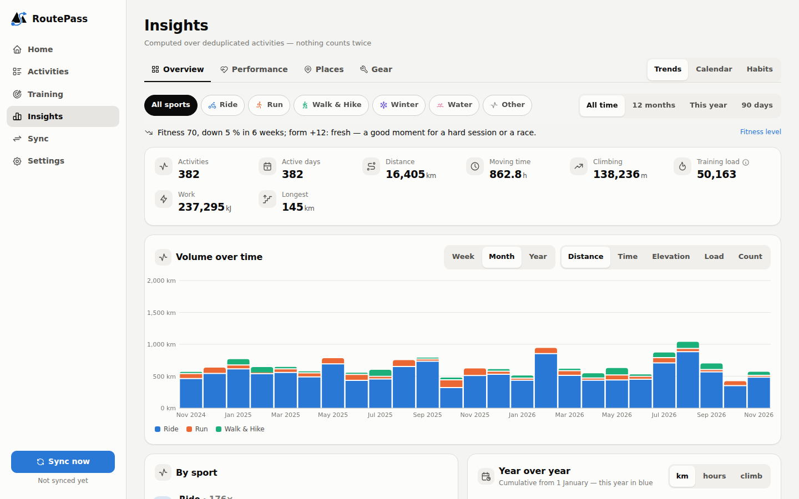
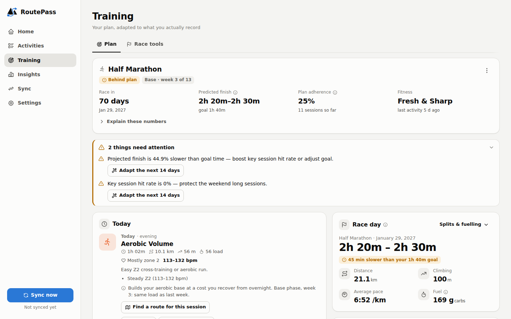
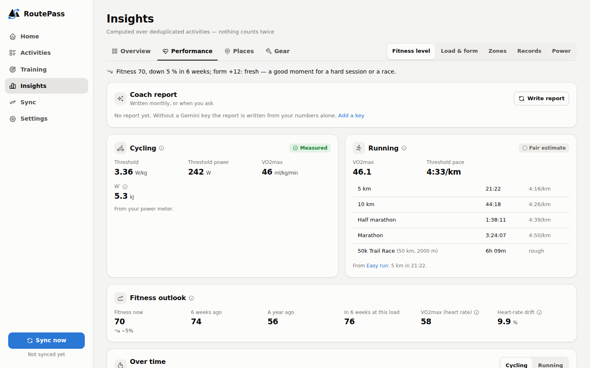
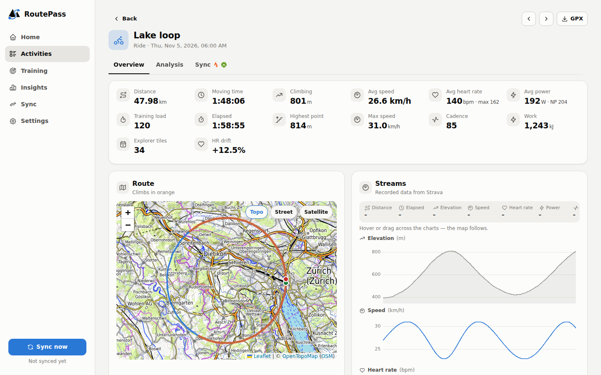

<!-- portfolio:date=2026-04-15 -->
# RoutePass

**[English](README.md) · [Deutsch](README.de.md)**

<p align="center"></p>

RoutePass is a self-hosted Strava ⇄ Komoot sync and training app for one athlete. Both platforms are merged into one deduplicated activity history that a FastAPI backend, a React web app and an MCP server for AI assistants all work on.

## Highlights

- **Deduplicating two-way sync** — Strava activities and Komoot tours are matched into one activity (±10 min, ±15 % distance); rules decide each copy and a retrying job queue respects Strava's rate limits.
- **LLM coach with guardrails** — Gemini runs on a background worker and only writes text or proposes plan changes; the code computes every number and rejects unsafe changes, with rule-based fallbacks.
- **Track analytics in NumPy** — despiked elevation gain, normalized power and TSS/hrTSS, heart-rate and power zones, climb detection, grade-adjusted pace (Minetti) and aerobic decoupling, checked against ten real Komoot recordings (distance within 1–4 %).
- **Fitness estimates from physics** — cycling threshold and VO2max from a power meter or, without one, from steady climbs (gravity, rolling and air resistance); running VO2max (Daniels VDOT), race predictions and a six-week fitness outlook.
- **Adaptive training plans** — periodised plans for trail, road, cycling and triathlon goals; recorded activities are matched to sessions and scored, effort ratings feed the load, and each session gets route suggestions from your history and Komoot.
- **One service layer, two interfaces** — 126 REST endpoints (OpenAPI) and 60 MCP tools call the same functions, so an AI assistant can do everything the web app does.
- **Small to run** — one container (API, scheduler, MCP, static web build) and one SQLite file in WAL mode with versioned migrations; stored credentials are Fernet-encrypted.

## Screenshots

<p align="center">
    
</p>

All screenshots use the synthetic demo data from `server/scripts/seed_demo.py`.

## Architecture

```
┌──────────────── routepass container (one Python process) ─────────────────┐
│  /             React app (static build)                                   │
│  /api/v1/*     REST (FastAPI, OpenAPI at /api/docs)  ─┐                   │
│  /mcp          MCP, streamable HTTP                  ─┼─► services.py     │
│  scheduler     sync cycle every 30 min / on webhook  ─┤    engine/        │
│  AI coach      background worker, one job at a time  ─┘    analysis/      │
│                                                                           │
│  SQLite (WAL)  /data/routepass.db       Fernet key  /data/secret.key      │
└───────────────────────────────────────────────────────────────────────────┘
```

### Capabilities & Sync Mechanics

- **Sync** — Komoot → Strava and Strava → Komoot, each switchable. Rules (sport, distance, climbing, duration, name, weekday, date, commute/indoor, heart rate/power, places) skip or shape a copy: title and description templates, sport mapping, visibility, gear. A dry run shows what a rule would do before anything is uploaded. Every Strava sport type (50) and every recordable Komoot sport (25) has an explicit mapping, enforced by tests.
- **One history** — RoutePass recognises its own uploads, never copies an activity that already exists on the target, and waits a settle delay so devices that upload to both platforms arrive first. Wrong matches can be split or merged by hand. Copies follow the original's visibility; photos from both platforms are shown per activity.
- **Analysis** — dashboard with period comparison, volume by sport, year over year, calendar heatmap, fitness/fatigue/form (CTL/ATL/TSB), records and best efforts, power curve, zones with polarisation, efficiency trend, habits, streaks, Eddington number, Explorer tiles, gear mileage and a map of every route. Per activity: map linked to stream charts, splits, climbs (with estimated watts on rides without a power meter), zones and best efforts.
- **Training** — plans with phases, key sessions, a race prediction and calendar export; "shorter / easier / swap" options for a single day; skip reasons (no time, illness, soreness or fatigue, injury) that reshape the following days.
- **AI coach (optional, Gemini)** — writes the next two weeks' sessions with your personal zones, adapts the next 14 days after training or a note, comments on each matched workout, writes a weekly review and a monthly fitness report, and analyses single activities on request. It runs within a monthly spending cap; when Gemini is unavailable or over quota, the built-in rules take over and the app says why.
- **History (v1 → v2)** — v1 started as a multi-tenant FastAPI + PostgreSQL + Redis/ARQ service; v2 is the streamlined single-athlete container with SQLite (WAL) and an in-process background worker.

- **Sync cycle** (`engine/runner.py`): import both platforms incrementally → match records into activities (`engine/ingest.py`) → plan copies by rules (`engine/sync.py`) → upload as GPX with heart rate, cadence and power → download recordings in the background. Failed uploads retry with backoff (15 min to 12 h, at most 5 attempts); rate limits defer a job without counting an attempt, and background work keeps part of Strava's 15-minute and daily limits free.
- **Analysis** (`analysis/`): pure NumPy track metrics; aggregates read only the deduplicated `activities` table, so nothing is counted twice.
- **Two listeners in one process**: a private port for the web app (session cookies after sign-in) and an optional public port that serves only `/api/v1/*` and `/mcp` with a bearer token, for OAuth callbacks, Strava webhooks and remote MCP clients.
- **AI calls** never run inside a request or an open database transaction: each job reads in one short session, calls Gemini with none open, and validates and writes the answer in another.

More detail: [docs/ARCHITECTURE.md](docs/ARCHITECTURE.md).

### Strava access

Since mid-2026 Strava's API only works while the app owner has a paid subscription. RoutePass works with the API, with Strava's free personal data export (complete history with original FIT/GPX/TCX files), or with an optional browser-session connector. That connector uses the website rather than the API, which Strava's terms do not allow; see the architecture notes before using it.

## Tech Stack

**Backend:** Python 3.12 · FastAPI · SQLAlchemy · SQLite · NumPy · httpx · MCP Python SDK · Gemini API
**Frontend:** React · TypeScript · Vite · TanStack Query · uPlot · Leaflet · Tabler Icons · PWA
**Delivery:** Docker (multi-stage build) · GitHub Actions → GitHub Container Registry · pytest with respx-mocked provider APIs (85 tests) · Ruff

## Getting Started

```bash
cp .env.example .env            # set ROUTEPASS_API_TOKEN, optionally your Strava app id/secret
docker compose up --build       # http://localhost:8000
```

Then connect Strava and Komoot in **Settings**. The first import starts right away; recordings are downloaded in the background.

| Variable | Default | Meaning |
|---|---|---|
| `ROUTEPASS_API_TOKEN` | *(empty)* | Bearer token for API and MCP clients; also a fallback web sign-in |
| `ROUTEPASS_ALLOWED_EMAILS` | *(empty)* | Who may sign in to the web app (comma-separated) |
| `ROUTEPASS_BASE_URL` | `http://localhost:8000` | URL users open; builds the Strava OAuth redirect |
| `ROUTEPASS_PUBLIC_URL` | | Internet-facing URL that exposes only the API paths (OAuth callback, webhook, REST, MCP) |
| `ROUTEPASS_PORT` / `ROUTEPASS_PUBLIC_PORT` | `8000` / off | Private listener (web app) and optional public listener (API paths only) |
| `ROUTEPASS_STRAVA_CLIENT_ID` / `_SECRET` | | Strava API app (can also be entered in Settings) |
| `ROUTEPASS_STRAVA_WEBHOOK_VERIFY_TOKEN` | | Shared secret for Strava push events (instant sync) |
| `ROUTEPASS_GOOGLE_CLIENT_ID` / `_SECRET` | | Optional "Sign in with Google" |
| `ROUTEPASS_TRUST_TAILSCALE_HEADERS` | `false` | Sign in from the identity header set by `tailscale serve` (private port only) |
| `ROUTEPASS_GEMINI_API_KEY` | | Optional AI coach key (can also be entered in Settings) |
| `ROUTEPASS_SECRET_KEY` | generated | Fernet key for stored credentials (else `/data/secret.key`) |
| `ROUTEPASS_POLL_INTERVAL_MINUTES` | `30` | Automatic sync: `0` = manual only, else 30/60/120/360 |
| `ROUTEPASS_DATA_DIR` | `/data` | SQLite database and key |

### MCP

```json
{ "mcpServers": { "routepass": { "type": "http", "url": "https://<your-host>/mcp",
  "headers": { "Authorization": "Bearer <ROUTEPASS_API_TOKEN>" } } } }
```

The tools cover sync status and runs, activity search and detail, all insights, fitness estimates, training plans and sessions, rules (with dry run), the job queue and manual merge/split/lock of single activities.

### Develop

```bash
cd server && python -m venv .venv && . .venv/bin/activate && pip install -r requirements-dev.txt
pytest && ruff check . && ruff format --check .
ROUTEPASS_DATA_DIR=./data python -m scripts.seed_demo   # optional: two years of synthetic data
uvicorn routepass.asgi:app --reload                     # :8000

cd web && npm ci && npm run dev                         # :5173, proxies /api and /mcp
```

Licensed under **MIT**.
